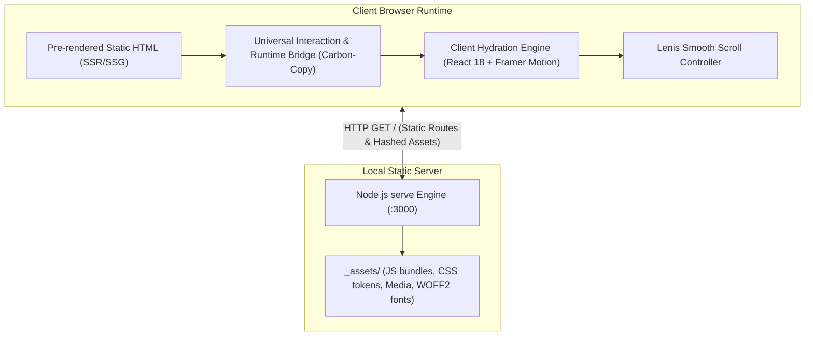

# Architecture Overview — BirthLab Studio

> **Status:** Living Document  
> **Repository:** BirthlabStudio.com  
> **Stack:** Multi-Page Static Site Architecture (Framer SSG Export + React Hydration / Motion Runtime)  
> **Hosting / Local Runtime:** Node.js `serve` on `http://localhost:3000`

---

## 1. Project Structure

```text
BirthlabStudio.com/
├── package.json              # Project scripts (dev/start/find-asset) & dependencies
├── package-lock.json         # Pinned dependency lockfile
├── AGENTS.md                 # Agent operating rules & dev server guardrails
├── ARCHITECTURE.md           # This document
├── ACCESSIBILITY.md          # Accessibility targets, audit findings & roadmap
├── serve.json                # Static file server routing & security headers
├── docs/                     # Centralized documentation & audit reports
│   ├── README.md             # Documentation index
│   ├── ASSET_AUDIT_REPORT.md # 552-asset segment breakdown
│   ├── ARCHITECTURE_AUDIT_REPORT.md # Stack & architecture analysis
│   ├── security-audit-report.md # OWASP Top 10 security audit
│   ├── PROJECT_SKILLS.md     # 8-Phase engineering lifecycle
│   └── _manifest.json        # Origin snapshot archive
├── scripts/                  # Developer CLI utilities
│   └── find-asset.mjs        # Interactive asset search tool (npm run find-asset)
├── index.html                # Root homepage entrypoint
├── 404/                      # Not-Found fallback view
│   └── index.html
├── about/                    # Studio & artist biographical profile
│   └── index.html
├── contact/                  # Studio contact page
│   └── index.html
├── work/                     # Complete portfolio gallery index
│   └── index.html
├── case-studies/             # 17 Discrete client case study projects
│   ├── 121g/index.html
│   ├── beyondtellerrand/index.html
│   ├── bigeye/index.html
│   ├── epic-travel/index.html
│   ├── getty-images/index.html
│   ├── justphil/index.html
│   ├── kapilandholly/index.html
│   ├── linkboard/index.html
│   ├── lumaandleaf/index.html
│   ├── mikesbeer/index.html
│   ├── mixd/index.html
│   ├── plug-digital/index.html
│   ├── slashwork/index.html
│   ├── snapsound/index.html
│   ├── thebodyshop/index.html
│   ├── tvs/index.html
│   └── x/index.html
└── assets/                   # Segment-wise organized asset repository
    ├── hero/                 # Hero video reel and splash visuals
    ├── work-highlights/      # Portfolio preview cards (human-readable names)
    ├── case-studies/         # 17 segmented client project folders
    ├── about/                # Bio portrait, founder showreel, and book covers
    ├── 404/                  # Animations and visuals for 404 view
    ├── fonts/                # Self-hosted typography (Manrope, Geist Mono, serifs)
    ├── runtime-scripts/      # React 18, Framer Motion, Lenis runtime modules
    ├── audio/                # Soundscapes and media audio tracks
    ├── shared/               # Cross-page icons, illustrations, and fallback media
    └── manifest.json         # Bidirectional asset mapping lookup table
```

---

## 2. High-Level System Diagram



---

## 3. Core Components & Runtime Analysis

### 3.1. Frontend Static HTML Shell
- **Format:** Pre-rendered HTML5 pages generated by Framer SSG with inlined CSS custom property design tokens and SVG symbol definitions.
- **Routing Engine:** Path-based directory routing. 22 independent pages, each with its own `index.html` file, enabling clean server resolution without requiring URL rewrites.

### 3.2. Universal Interaction & Runtime Bridge
- **Injected Script:** `Carbon-Copy Universal Interaction & Runtime Bridge`.
- **Purpose:** 
  - Prevents external telemetry/analytics blocking calls (mocks `dataLayer`, `gtag`, `fbq`, `hj`, `Sentry`, `grecaptcha`).
  - Unregisters service workers that could hijack local offline assets.
  - Intercepts mock `/api/` fetch calls.
  - Automatically awakens the page layout and triggers scroll/resize recalculation events.

### 3.3. React & Framer Motion Hydration Layer
- **Engine:** Rolldown-bundled ES modules (`react.CjnUlh73.mjs`, `framer.C9lQrCoq.mjs`, `motion.i8N3zRfX.mjs`).
- **Functionality:** Drives interactive micro-interactions, responsive viewport breakpoint swapping (`__framer__breakpoints`), hover states, and smooth staggered entrance animations.

### 3.4. Asset Pipeline
- **Structure:** Flat directory in `_assets/` containing 552 files totaling ~360 MB.
- **Assets include:**
  - Self-hosted WOFF2 web fonts (eliminating third-party Google Fonts requests).
  - High-resolution client photography, case study artwork, and brand identities.
  - Looping MP4 video showcases (e.g., hero video reels).
  - SVG sprite definitions embedded directly at the bottom of each document.

---

## 4. Data Stores & State Management

- **Persistence:** Pure client-side static site; no server-side database.
- **Client State:**
  - Component animation state managed internally via Framer Motion.
  - Breakpoint tracking through media query listeners.
  - LocalStorage checks for Framer internal tooling (e.g. `__framer_force_showing_editorbar_since`).

---

## 5. Deployment & Infrastructure

- **Current Runtime:** Node.js `serve` static server with pinned compression overrides.
- **Hosting Compatibility:** 100% compatible with static edge hosting:
  - Vercel (zero-config static deployment)
  - Cloudflare Pages
  - GitHub Pages
  - Netlify / AWS S3 + CloudFront

---

## 6. Security Architecture

- **Dependency Security:** All npm dependencies scanned via `npm audit` with zero reported vulnerabilities.
- **Isolated Offline Sandbox:** External tracking services are stubbed, preventing data leakage.
- **Hardening Priorities:**
  - Remove unnecessary external iframe embeds (`__framer-editorbar`).
  - Implement Content Security Policy (CSP) headers.

---

## 7. Project Identification

- **Project Name:** BirthLab Studio
- **Primary Domain:** `https://birthlabstudio.com`
- **Architectural Pattern:** Static Site Generation (SSG) with Micro-Hydration
- **Local Dev Server:** `http://localhost:3000`
