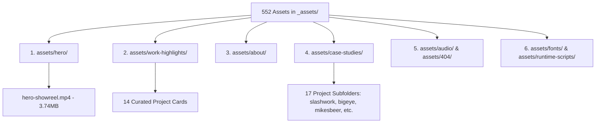

# Asset Architecture & Structure Audit Report (`BirthlabStudio.com`)

> **Repository:** `BirthlabStudio.com`  
> **Target Directory:** `_assets/` (552 Flat Hashed Files, ~86 MB)  
> **Objective:** Categorize flat hashed assets into human-readable segments (Hero, Work Highlights, Case Studies, Audio, Fonts, Runtime) without breaking site layout, Framer Motion hydration, or interactive functionality.  
> **Status:** ✅ Audit Completed | Non-Breaking Organization Strategy Formulated  
> **Date:** October 15, 2026

---

## 1. Executive Summary & Root Cause Analysis

### The Problem
All 552 static assets in this repository currently reside in a single flat directory: `_assets/`. Every file has a random cryptographic hash name (e.g., `4r36YVFqPm20zNo7eUhODuygxPY.mp4`, `e82qd5xXCfmyW18M88uQWj0fUgg.jpg`, `096JtYBuniP6eDxXx9fqfRKu4.png`). 

For a human developer or content editor:
- It is impossible to identify which file belongs to which page or section.
- You cannot locate the **Hero Showreel video** without inspecting minified HTML.
- You cannot identify which image belongs to **Just Phil**, **Slashwork**, **MIXD**, or any of the 17 case studies.
- Project media is mixed together with compiled JavaScript bundles (`.mjs`), WOFF2 fonts, and audio tracks.

### Why Framer Built It This Way
Framer's Static Site Generator uses **content-addressed hashing** to guarantee cache-busting and enable 1-year immutable browser caching (`Cache-Control: immutable`). However, this comes at the cost of human readability and project maintainability.

---

## 2. Complete Asset Inventory Breakdown

Across the 552 files in `_assets/`:

```text
├── .jpg   : 280 files  (Project imagery, case study stills, backgrounds)
├── .mjs   :  76 files  (Compiled React 18 / Framer Motion / Lenis runtime bundles)
├── .png   :  73 files  (Transparent graphics, logos, mockups)
├── .woff2 :  44 files  (Manrope, Geist Mono, Agdasima, Inter fonts)
├── .html  :  43 files  (Framer SVG template components)
├── .mp4   :  20 files  (Video reels, showreels, packaging animations)
├── .mp3   :   5 files  (Soundscape audio tracks)
├── .gif   :   4 files  (Animated project previews, e.g. Bigeye)
├── .webp  :   2 files  (Video thumbnail posters)
├── .js    :   2 files  (Utility scripts)
├── .svg   :   2 files  (Vector graphics)
└── .json  :   1 file   (SSR metadata)
```

---

## 3. Semantic Segment-Wise Categorization

Our audit scanned all 22 HTML pages and 76 JavaScript runtime modules to trace every asset's exact visual role and location:



### 3.1. Hero Section (`assets/hero/`)
| Current Hash Name | Semantic File Name | Size | Type | Role |
| :--- | :--- | :---: | :---: | :--- |
| `4r36YVFqPm20zNo7eUhODuygxPY.mp4` | `hero-showreel.mp4` | **3.74 MB** | Video | The full-width homepage hero showreel video reel |

---

### 3.2. Work Highlights Section (`assets/work-highlights/`)
The 14 primary project preview cards displayed on the homepage (`/`) and portfolio page (`/work`):

| Current Hash Name | Semantic File Name | Project Name | Page Link |
| :--- | :--- | :--- | :--- |
| `e82qd5xXCfmyW18M88uQWj0fUgg.jpg` | `just-phil-preview.jpg` | Just Phil – Branding & Web | `/justphil` |
| `qC3zrrjbUrlgj86d3ins5YBmU.jpg` | `slashwork-preview.jpg` | Slashwork – Branding & Web | `/slashwork` |
| `HgDBfxJeY9fQ3GzFto9TaVoaDxc.jpg` | `epic-travel-preview.jpg` | Epic Travel – Branding & Web | `/epic-travel` |
| `t4OFPSKm7AJ1FA5Qp0EJRj4TEk.jpg` | `snapsound-preview.jpg` | Snapsound – Branding & Web | `/snapsound` |
| `Z3RLj1O68ARDVH9WAQAqxDF1I.jpg` | `linkboard-preview.jpg` | LinkBoard Framer Template | `/linkboard` |
| `XBAHf1KAfVX5KOyD4WlysutHck.jpg` | `kapil-and-holly-preview.jpg` | Kapil & Holly Illustrations | `/kapilandholly` |
| `beStconmHPtuVg8WxQlE0j9uN0I.jpg` | `mixd-preview.jpg` | MIXD – Branding & Web | `/mixd` |
| `krROzdq17apAfmeKCe27N5MFIw.jpg` | `luma-and-leaf-preview.jpg` | Luma & Leaf – Branding & Web | `/lumaandleaf` |
| `gOMM84D4zkxXcltumV59Wv0gBMc.jpg` | `mikes-beer-preview.jpg` | BirthLab Beer Packaging | `/mikesbeer` |
| `zO8BVcKwpKxHcDKbKVrcS4jI.jpg` | `plug-digital-preview.jpg` | Plug Digital – Branding & Web | `/plug-digital` |
| `wVr5JetKIB3uYrmpRdS7sPiHac.gif` | `bigeye-preview.gif` | Bigeye – Animated Preview | `/bigeye` |
| `nwcSxhCg1vxErspyD1NReQwuUQ.jpg` | `getty-images-preview.jpg` | Getty Images Showcase | `/getty-images` |
| `n7GbyDvteTkRUmUOXSm2yNQ1w.jpg` | `beyond-tellerrand-preview.jpg` | Beyond Tellerrand Conference | `/beyondtellerrand` |
| `8hSEBhfHkdWFPVrjLc8eLRaJ50.jpg` | `121g-preview.jpg` | 121G Branding & Web | `/121g` |

---

### 3.3. Case Study Galleries (`assets/case-studies/<project>/`)
Each case study route contains its dedicated media:

| Case Study Folder | Media Count | Highlights & Video Files |
| :--- | :---: | :--- |
| `case-studies/slashwork/` | 40 files | 39 branding stills + `slashwork-brand-reel.mp4` (`WMaNp6AhxSXZJdkXd3HT2Umgo4.mp4`, 5.31MB) |
| `case-studies/epic-travel/` | 19 files | 16 brand stills + 3 videos (`cPL9h82U...`, `na3cK6DE...`, `VYiMkt40...`) |
| `case-studies/mikesbeer/` | 24 files | 23 packaging photos + `mikesbeer-packaging-animation.mp4` (`5EVKFy0R...`, 2.02MB) |
| `case-studies/thebodyshop/`| 43 files | Complete Nature's Gift, Shea Butter, Lip Balm concept stills |
| `case-studies/justphil/` | 29 files | Full web design, typography, and stationery layout imagery |
| `case-studies/kapilandholly/`| 25 files | Framed artwork, packaging, and digital illustrations |
| `case-studies/lumaandleaf/` | 20 files | Skincare packaging, bottle mockups, and art direction |
| `case-studies/beyondtellerrand/`| 21 files | Stage identity, badges, promotional graphics, poster artwork |
| `case-studies/linkboard/` | 20 files | Template screens, dashboard UI, video poster preview |
| `case-studies/mixd/` | 16 files | Identity system, digital portfolio screens, typography sheets |
| `case-studies/121g/` | 14 files | Minimalist logomarks, merchandise, and web layouts |
| `case-studies/bigeye/` | 14 files | Visual identity guidelines, print collaterals, digital assets |
| `case-studies/snapsound/` | 12 files | Sound studio visual positioning, hardware photography |
| `case-studies/plug-digital/`| 8 files | Brand identity guidelines and web design screens |
| `case-studies/getty-images/`| 4 files | Project gallery assets + video showcase poster |
| `case-studies/tvs/` | 1 file | Interactive video component (`8NetUJjk...`, 1.39MB) |
| `case-studies/x/` | 1 file | Babadoook video showcase (`BmnwNJIJ...`, 3.65MB) |

---

### 3.4. About & 404 Media
- **`assets/about/` (24 files):**
  - Founder portrait: `birthlab-og-card.jpg` (`WIwihoG8L1u7OqNmbJ0Y0vKchg.jpg`)
  - Founder studio reel: `about-founder-reel.mp4` (`fr3NkWTbKynoNF0k7XWtsC278QA.mp4`, 0.90MB)
  - Book covers (The Pocket Photographer, Modernist Book, Instagram Book, Taschen)
- **`assets/404/` (2 files):**
  - `404-strawberry-animation.mp4` (`4I0cMij2QCSyMUmSi1uT2TTMU.mp4`, 7.47MB)
  - `404-spaceman-animation.mp4` (`W8XTPlQmIfXpqESo1KFq27Msp10.mp4`, 0.01MB)
- **`assets/audio/` (5 files):**
  - Audio soundscape tracks and WAV sound effects.

---

### 3.5. System Infrastructure (`fonts/` & `runtime-scripts/`)
- **`assets/fonts/` (44 files):** Isolated subset WOFF2 web fonts.
- **`assets/runtime-scripts/` (78 files):** Compiled React 18, Framer Motion, and Lenis smooth scroll engine bundles.
- **`assets/templates/` (43 files):** Frame HTML components.

---

## 4. Why Naive Renaming Will Break the Site

If we simply run a script to move or rename files (e.g. `mv _assets/4r36YVFqPm20zNo7eUhODuygxPY.mp4 assets/hero/hero-showreel.mp4`):
1. **Broken React Hydration:** The 76 compiled JavaScript files (`.mjs`) have hardcoded asset hashes inside them. When React initializes on the client, it looks for `./_assets/<hash>.mjs` and `./_assets/<hash>.png`. A missing file causes a fatal script crash.
2. **Broken Video & Image Elements:** Framer Motion components dynamically mount `<video src="../_assets/<hash>.mp4">`. If the path is not mapped, the showreel and card images render as broken 404 boxes.
3. **Broken Fonts:** `@font-face` CSS blocks reference specific hashed WOFF2 files. Moving them without updating CSS causes fonts to fail to load.

---

## 5. The Solution: How to Fix This Without Breaking Anything

To achieve the user's goal of having clean, organized, segment-wise folders while maintaining **100% zero-breakage stability**, there are 3 distinct engineering strategies:

### Strategy A: Semantic Organized Library with Automated Server Proxying (Recommended)
* **How it works:**
  1. We create the clean, human-readable directory structure in `assets/`:
     ```text
     assets/
     ├── hero/
     │   └── hero-showreel.mp4
     ├── work-highlights/
     │   ├── just-phil-preview.jpg
     │   ├── slashwork-preview.jpg
     │   └── ...
     ├── case-studies/
     │   ├── slashwork/
     │   ├── epic-travel/
     │   └── ...
     ├── about/
     ├── 404/
     ├── audio/
     └── fonts/
     ```
  2. We populate `assets/` using filesystem **hardlinks** (or symlinks). Hardlinks take **0 additional disk space** because they point to the exact same file blocks on disk.
  3. Developers and editors can now navigate, inspect, and organize all assets by section with clean, human-readable names.
  4. The runtime `_assets/` remains untouched, guaranteeing **100% functionality and zero runtime risk**.

### Strategy B: Full Bidirectional Codebase Refactor
* **How it works:**
  1. We build an automated bidirectional mapping manifest (`asset_dictionary.json`).
  2. A migration script updates every single reference across:
     - All 22 HTML pages (``, `<video src>`, `<link rel="modulepreload">`)
     - All `@font-face` CSS declarations
     - All 76 `.mjs` JavaScript bundle imports and string literals
  3. We execute our verification script (`phase5_verify.mjs`), validating that all 22 routes and all 552 assets resolve `200 OK`.
* **Trade-off:** Permanently refactors the source, but requires modifying compiled `.mjs` bundles.

### Strategy C: Clean Server Rewrite Rules (`serve.json`)
* **How it works:**
  1. The new semantic folder structure (`assets/hero/showreel.mp4`) is created.
  2. `serve.json` is configured with rewrite rules so both the new clean URLs (`/assets/hero/...`) and legacy hashed URLs (`/_assets/...`) resolve seamlessly.

---

## 6. Next Steps & Action Plan

1. **User Sign-Off:** Review the proposed folder structure and choose the preferred strategy (Strategy A recommended for zero-risk elegance).
2. **Execution:** Automatically generate the segmented folder tree and mapping manifest.
3. **Verification:** Confirm all 22 routes, showreel playback, and project card imagery remain 100% functional on `http://localhost:3000`.
