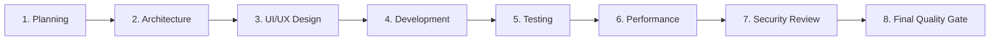

# Enterprise AI Project Skill Architecture (`PROJECT_SKILLS.md`)

> **Standard Operating Procedure (SOP) for AI-Assisted Project Engineering**  
> **Status:** Active Standard  
> **Scope:** Multi-Framework Web Applications (Astro, React, Vue, Next.js, Vite, Static Mirrors)

---

## 1. Executive Summary

This document governs how the AI Engineering Assistant interacts with this repository across the complete software delivery lifecycle. Rather than treating AI skills as an unstructured pool of tools, this architecture establishes an **8-Phase Stage-Gate Pipeline** that routes specific domain skills to discrete engineering phases.

---

## 2. Global Skill Inventory & Classification

Across this environment, cataloged skills are classified into 6 architectural tiers:

```text
[TIER 1: Governance & Meta]  ─── architecture, agents-md, accessibility-md, agy-customizations
[TIER 2: Discovery]         ─── awesome-skills-navigator
[TIER 3: UI/UX & Design]    ─── ui-ux-pro-max, ui-styling, design-system, brand, design, banner-design, slides
[TIER 4: Security & Risk]   ─── security-audit
[TIER 5: Accessibility/QA]  ─── 31 WCAG/A11y topic skills (keyboard, forms, contrast, aria-live, axe-rules, etc.)
[TIER 6: Platform]          ─── permissioned-github, antigravity-guide
```

---

## 3. The 8-Phase Lifecycle Workflow



### Phase 1: Project Planning & Discovery
* **Objective:** Define product scope, MVP boundaries, requirements, and missing tool discovery.
* **Assigned Skills:**
  - `agents-md`: Scaffold repository agent guardrails and dev server rules.
  - `awesome-skills-navigator`: Look up framework/library-specific recipes if new capabilities are required.
  - `brand`: Determine visual voice, tone, and audience positioning.
* **Deliverable:** Project brief and root `AGENTS.md`.

### Phase 2: Architecture & System Design
* **Objective:** Establish component hierarchies, layer boundaries, state management, and file trees.
* **Assigned Skills:**
  - `architecture`: Directory layouts, module boundaries, database schemas, and data flow diagrams.
  - `progressive-enhancement`: Enforce zero-JS fallback resilience and server/client hydration strategies.
  - `mermaid`: Generate accessible component interaction and state diagrams.
* **Deliverable:** `ARCHITECTURE.md` and initial repository scaffolding.

### Phase 3: UI/UX Design & Design Tokens
* **Objective:** Formulate visual aesthetics, color systems, typography, and reusable token specifications.
* **Assigned Skills:**
  - `ui-ux-pro-max` *(Orchestrator)*: Determine product palette, typography pairing, and aesthetic style archetype.
  - `design-system`: Generate 3-layer design tokens (`primitive` → `semantic` → `component`) and CSS variable starter tokens.
  - `color-contrast`: Verify all proposed token pairings meet WCAG 4.5:1 / 3:1 before code is written.
  - `light-dark-mode`: Define dual-theme contrast palettes and system theme media queries.
  - `banner-design` / `design`: Hero assets, marketing banners, and SVG iconography.
* **Deliverable:** Design tokens specifications and component specifications.

### Phase 4: Core Development & Implementation
* **Objective:** Build features, interactive components, forms, and pages.
* **Assigned Skills:**
  - `ui-styling`: CSS utility classes and accessible UI primitives.
  - `keyboard`: Focus rings, logical tab order, roving tabindex, escape triggers.
  - `forms`: Associated `<label>` elements, input validation, and aria-describedby error states.
  - `navigation`: Landmark semantics (`<nav>`, `<main>`, `<header>`), skip-links, and breadcrumbs.
  - `touch-pointer`: 44×44px hit targets and pointer cancellation.
  - `image-alt-text` & `svg`: Contextual alt text and semantic SVG markup.
  - `aria-live-regions`: Polite live region announcements for asynchronous operations.
* **Deliverable:** Working, hot-reloading code on the local dev server.

### Phase 5: Verification & Testing
* **Objective:** Validate functional behavior, accessibility compliance, and cross-browser resilience.
* **Assigned Skills:**
  - `axe-rules`: Automated WCAG 2.1/2.2 AA validation.
  - `behavioral-a11y`: Viewport reflow testing (SC 1.4.10) and visible focus verification (SC 2.4.7).
  - `manual-testing`: Keyboard-only walk-through and screen reader simulation routines.
  - `cli-audit`: Headless browser Playwright + Axe evaluation of live routes.
  - `bug-reporting`: Standardized finding triage with task impact descriptions.
* **Deliverable:** Test suite pass reports and accessibility validation logs.

### Phase 6: Performance & User Experience Optimization
* **Objective:** Optimize Core Web Vitals (LCP, CLS, INP) and respect user personalization.
* **Assigned Skills:**
  - `user-personalization`: Respect `prefers-reduced-motion` and `prefers-contrast`.
  - `ui-ux-pro-max` (Domain: `ux` performance): Layout shift prevention, asset lazy-loading, and font display strategy.
  - `content-design` & `plain-language`: Readability, concise microcopy, and clear error messaging.
* **Deliverable:** Sub-100ms interaction latency, zero layout shift (CLS < 0.1).

### Phase 7: Application Security & Hardening
* **Objective:** Identify vulnerabilities, supply chain risks, secret leaks, and misconfigurations.
* **Assigned Skills:**
  - `security-audit`: White-box & gray-box scan mapped to OWASP Top 10:2025 and NIST CSF 2.0.
  - Mode usage:
    - Rapid PR checks: `security-audit diff --fix`
    - Full pre-release: `security-audit full --fail-on high`
    - Surface checks: `security-audit focus:api` or `security-audit focus:auth`
* **Deliverable:** `security-audit-report.md` with zero Critical/High vulnerabilities.

### Phase 8: Final Quality Gate & Release
* **Objective:** Holistic digital quality signoff and governance documentation.
* **Assigned Skills:**
  - `accessibility-md`: Generate/update the project's living `ACCESSIBILITY.md` manifest.
  - `opquast-digital-quality`: 245-rule digital quality verification (privacy, security, links, SEO, usability).
  - `ci-cd`: GitHub Actions quality gates and branch protection policies.
* **Deliverable:** Production release candidate and deployment sign-off.

---

## 4. Activation Governance: Always-On vs. On-Demand

| Mode | Criteria | Skills Included |
| :--- | :--- | :--- |
| **Always-On (Core Baseline)** | Essential for every prompt and session; dictates fundamental conventions and system rules. | `agents-md`, `architecture`, `ui-styling`, `keyboard`, `color-contrast` |
| **On-Demand (Feature-Triggered)** | Activated only when the specific feature or technology is introduced to the codebase. | `forms`, `charts-graphs`, `audio-video`, `maps`, `svg`, `tooltips`, `aria-live-regions`, `print`, `slides`, `banner-design` |
| **Milestone-Triggered (Phase-Specific)** | Invoked at designated pipeline checkpoints (PR creation, pre-deploy, audit phase). | `security-audit`, `axe-rules`, `cli-audit`, `manual-testing`, `behavioral-a11y`, `opquast-digital-quality` |
| **Meta / Discovery** | Invoked when seeking external capabilities or configuring IDE tools. | `awesome-skills-navigator`, `agy-customizations`, `antigravity-guide` |

---

## 5. Conflict & Redundancy Matrix

| Potential Conflict | Precedence Rule | Rationale |
| :--- | :--- | :--- |
| `ui-ux-pro-max` vs. `design` | **Use `ui-ux-pro-max` for application code; use `design` only for visual branding & asset generation.** | `ui-ux-pro-max` has deep code awareness (React, Vue, Tailwind, performance). `design` focuses on marketing collateral and presentation slides. |
| `ui-styling` vs. `design-system` | **Use `design-system` in Phase 3 (Tokens); use `ui-styling` in Phase 4 (Components).** | Prevents mixing raw token architecture with component implementation classes. |
| `content-design` vs. `plain-language` | **Run `content-design` first for information architecture; run `plain-language` second for copy editing.** | `content-design` fixes heading hierarchies and scan-ability; `plain-language` simplifies sentence mechanics. |
| `axe-rules` vs. `cli-audit` | **Use `axe-rules` during unit/component test authoring; use `cli-audit` for live page URL testing.** | Separation between static/component testing and runtime integration testing. |

---

## 6. Standard Project Skill Directory Architecture

```text
BirthlabStudio.com/
├── .agents/
│   ├── rules/
│   │   ├── project-conventions.md   # Project-specific rules
│   │   └── testing-standards.md     # Test execution rules
│   └── skills/                      # Repo-local specialized skills
├── AGENTS.md                        # Master agent contract & dev server guardrails
├── ARCHITECTURE.md                  # System architecture, data flow, directory layout
├── ACCESSIBILITY.md                 # Accessibility conformance target & audit log
├── PROJECT_SKILLS.md                # This file (Pipeline & Skill Router)
└── package.json                     # Project scripts and dependency management
```
